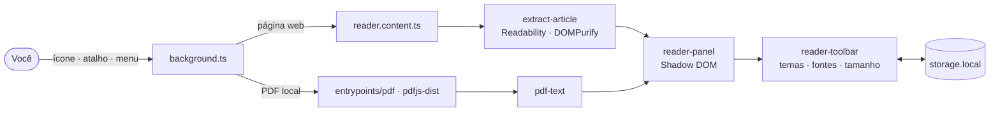

<!-- markdownlint-disable MD033 MD041 -->
<div align="center">

<picture>
  <source media="(prefers-color-scheme: dark)" srcset="assets/brand/banner-dark.svg">
  
</picture>

<br><br>

**Uma extensão para transformar páginas web e PDFs locais em uma leitura tranquila.**

<br>

[](https://github.com/BrunodosSantosVaz/lessentiel/releases)
[](https://github.com/BrunodosSantosVaz/lessentiel/actions/workflows/bb-ci.yml)
[](https://github.com/BrunodosSantosVaz/lessentiel/actions/workflows/bb-codeql.yml)
[](LICENSE)
<br>
[](https://chromewebstore.google.com/detail/l%E2%80%99essentiel/fcenhpjbliogldghnalpcnibefemhdof)
[](wxt.config.ts)
[](https://wxt.dev)
[](public/_locales)

<br>

<a href="https://chromewebstore.google.com/detail/l%E2%80%99essentiel/fcenhpjbliogldghnalpcnibefemhdof"></a>
<a href="https://github.com/BrunodosSantosVaz/lessentiel/releases"></a>
<a href="https://github.com/BrunodosSantosVaz/lessentiel/wiki/Uso-e-instalacao"></a>
<a href="https://github.com/BrunodosSantosVaz/lessentiel/wiki"></a>

</div>

<!-- Capturas de tela: adicione imagens reais do leitor em assets/screenshots/ e descomente.
<p align="center">
  
  
</p>
-->

<br>

<details>
<summary><b>Sumário</b></summary>

- [O texto em primeiro lugar](#-o-texto-em-primeiro-lugar)
- [Funcionalidades](#-funcionalidades)
- [Instalação](#-instalação)
- [Como usar](#-como-usar)
- [Temas e fontes](#-temas-e-fontes)
- [Privacidade e permissões](#-privacidade-e-permissões)
- [Arquitetura](#-arquitetura)
- [Desenvolvimento](#-desenvolvimento)
- [Contribuindo](#-contribuindo)
- [Segurança](#-segurança)
- [Licença](#-licença)

</details>

## 📖 O texto em primeiro lugar

<table>
<tr>
<td width="33%" valign="top">

### 🎚️ Leia no seu ritmo
Temas, fontes incluídas, tamanho, alinhamento, largura e rolagem automática.

</td>
<td width="33%" valign="top">

### 🧭 Mantenha o contexto
Índice hierárquico, citações, listas, tabelas, código e imagens editoriais opcionais.

</td>
<td width="33%" valign="top">

### 🔒 Fique no seu dispositivo
Processamento local de texto e preferências, sem conta ou sincronização.

</td>
</tr>
</table>

## ✨ Funcionalidades

| | Leitura | | Navegação |
|:-:|---|:-:|---|
| 🌐 | Extrai o texto principal de páginas web | 📑 | Índice hierárquico lateral com os títulos do artigo |
| 📄 | Abre PDFs locais e recompõe o texto em parágrafos e uma coluna | ⌨️ | Atalho <kbd>Alt</kbd> + <kbd>Shift</kbd> + <kbd>R</kbd> |
| 🔤 | Quatro fontes de leitura, três delas incluídas no pacote | 🖱️ | Menu de contexto *Abrir no L’Essentiel* |
| 🎨 | Temas claro, sépia, escuro, preto e automático | ⚡ | Ativação automática em sites escolhidos e em arquivos locais |
| ↔️ | Tamanho, alinhamento e largura da coluna | 📊 | Barra de progresso de leitura |
| ▶️ | Rolagem automática | 🖨️ | Impressão limpa, só com o texto |
| 🖼️ | Imagens editoriais opcionais | 🌍 | Interface em português, inglês e espanhol |

## 🚀 Instalação

<a href="https://chromewebstore.google.com/detail/l%E2%80%99essentiel/fcenhpjbliogldghnalpcnibefemhdof"></a>

A forma mais simples, com atualizações automáticas.

**Versão: [0.1.1](https://github.com/BrunodosSantosVaz/lessentiel/releases/tag/v0.1.1)** · [Baixar ZIP](https://github.com/BrunodosSantosVaz/lessentiel/releases/download/v0.1.1/lessentiel-v0.1.1-universal.zip)

| Navegador | Suporte |
|---|---|
|  | ✅ |
|  | ✅ |
| Outros Chromium (por exemplo, Brave) | Esperado, sem teste oficial |

<details>
<summary><b>Instalação manual pelo ZIP</b></summary>

1. Baixe o ZIP da versão desejada em [Releases](https://github.com/BrunodosSantosVaz/lessentiel/releases). As prévias estão identificadas como homologação.
2. Extraia o arquivo.
3. Abra `chrome://extensions` e ative o **Modo do desenvolvedor**.
4. Clique em **Carregar sem compactação** e selecione a pasta extraída.

Detalhes, acesso a arquivos, PDFs compatíveis e limitações estão no [guia de uso](https://github.com/BrunodosSantosVaz/lessentiel/wiki/Uso-e-instalacao).

</details>

## 🖱️ Como usar

1. Abra um artigo ou um PDF local.
2. Clique no ícone do L’Essentiel, use <kbd>Alt</kbd> + <kbd>Shift</kbd> + <kbd>R</kbd> ou escolha **Abrir no L’Essentiel** no menu de contexto.
3. Ajuste tema, fonte, tamanho, alinhamento e largura na barra superior.
4. Repita o comando para voltar à página original.

> [!NOTE]
> PDFs locais abrem primeiro no visualizador do navegador. Ative e desative o leitor manualmente. Para ler arquivos locais, permita o acesso a URLs de arquivo nos detalhes da extensão.

## 🎨 Temas e fontes

| Tema | Fundo | Texto | Link |
|---|:-:|:-:|:-:|
| **Claro** |  `#FFFFFF` |  `#222222` |  `#1A4FB4` |
| **Sépia** |  `#FAF7F0` |  `#342D22` |  `#7A4B12` |
| **Escuro** |  `#292A2D` |  `#D4D4D4` |  `#8AB4F8` |
| **Preto** |  `#000000` |  `#E6E6E6` |  `#8AB4F8` |
| **Automático** | Segue o tema do sistema | | |

**Fontes de leitura:** Georgia, Literata, Atkinson Hyperlegible Next e Lexend. As três últimas vêm empacotadas na extensão (OFL), sem chamadas externas.

## 🔐 Privacidade e permissões

- O texto e as preferências são processados localmente, sem conta, servidor ou sincronização.
- A extensão instalada não precisa de variáveis de ambiente nem de chaves.

| Permissão | Para quê |
|---|---|
| `activeTab` · `scripting` | Abrir o leitor na aba atual quando você pede |
| `contextMenus` | Item *Abrir no L’Essentiel* no menu de contexto |
| `storage` | Guardar suas preferências no navegador |
| `file:///*` | Ler páginas e PDFs locais |
| `http://*/*` · `https://*/*` (opcional) | Ativação automática só nos sites que você escolher |

## 🏛️ Arquitetura



<details>
<summary><b>Stack completa</b></summary>

| Camada | Tecnologia |
|---|---|
| Framework de extensão | [WXT](https://wxt.dev) · Manifest V3 |
| Linguagem | TypeScript |
| Extração de artigo | `@mozilla/readability` |
| Sanitização | `dompurify` |
| PDF | `pdfjs-dist` |
| Testes | Vitest · Playwright (aceite e regressão) |
| Lint e formatação | oxlint · oxfmt |

</details>

## 🛠️ Desenvolvimento

**Pré-requisitos:** Node.js e npm.

```bash
git clone https://github.com/BrunodosSantosVaz/lessentiel.git
cd lessentiel
npm ci
npm run dev
```

| Comando | O que faz |
|---|---|
| `npm run dev` | Abre o navegador com a extensão em modo de desenvolvimento |
| `npm run build` | Compila a extensão |
| `npm run package` | Gera o ZIP |
| `npm test` | Testes unitários (Vitest) |
| `npm run test:acceptance` | Testes de aceite e regressão (Playwright) |
| `npm run test:coverage` | Cobertura (mínimo de 80%) |
| `npm run lint` · `npm run typecheck` | Lint, formatação e tipos |

<details>
<summary><b>Perfis de compilação</b></summary>

| Variável | Uso |
|---|---|
| `MLA_FEATURE_READER` | Liga o leitor no build |
| `MLA_TEST_MODE` | Build de teste com permissões para testes headless |
| `BB_RC` | Identifica a candidata na esteira |

Comandos, permissões e verificação dos pacotes: [Wiki → Operação](https://github.com/BrunodosSantosVaz/lessentiel/wiki/Operacao).

</details>

## 🤝 Contribuindo

Encontrou um problema? [Abra uma issue](https://github.com/BrunodosSantosVaz/lessentiel/issues). Dúvidas e ideias vão para as [Discussions](https://github.com/BrunodosSantosVaz/lessentiel/discussions). Acompanhe o [quadro público](https://github.com/users/BrunodosSantosVaz/projects/33) e o [histórico de versões](https://github.com/BrunodosSantosVaz/lessentiel/releases).

Este projeto é construído com o framework [Big Bang](https://github.com/BrunodosSantosVaz/big-bang): uma pessoa decide, IAs executam, e toda mudança passa por uma esteira com testes, revisão e homologação.

1. Trabalhe numa branch a partir de `develop` (bugs a partir de `main`).
2. Use [Conventional Commits](https://www.conventionalcommits.org/pt-br/) em inglês. Issues, PRs e documentação em português do Brasil.
3. Bug: o primeiro commit traz o teste que falha, a correção vem no segundo.
4. Abra o PR com *O que muda*, *Testes* e *Issue* (`Refs #n`). A CI precisa ficar verde.

Leia o [guia de contribuição](CONTRIBUTING.md), o [`AGENTS.md`](AGENTS.md) e o [código de conduta](CODE_OF_CONDUCT.md).

## 🛡️ Segurança

Não abra issue pública com detalhes de uma vulnerabilidade. Use o [relato privado](https://github.com/BrunodosSantosVaz/lessentiel/security/advisories/new) do GitHub; se ele não estiver disponível, abra uma issue só pedindo contato, sem detalhes. Todo PR passa por varredura de segredos, análise estática, dependências e CodeQL. Veja a [política de segurança](SECURITY.md).

## 📄 Licença

Distribuído sob a licença [MIT](LICENSE). Fontes Literata, Atkinson Hyperlegible Next e Lexend sob OFL. O framework [Big Bang](https://github.com/BrunodosSantosVaz/big-bang) mantém sua [licença própria](.bigbang/LICENSE).

<div align="center">

<br>


<sub>Por <a href="https://github.com/BrunodosSantosVaz">Bruno dos Santos Vaz</a></sub>

<br><br>

<a href="https://star-history.com/#BrunodosSantosVaz/lessentiel&Date">
  
</a>

<br>

<sub>Se o L’Essentiel deixa sua leitura mais tranquila, deixe uma ⭐ no repositório.</sub>

</div>
