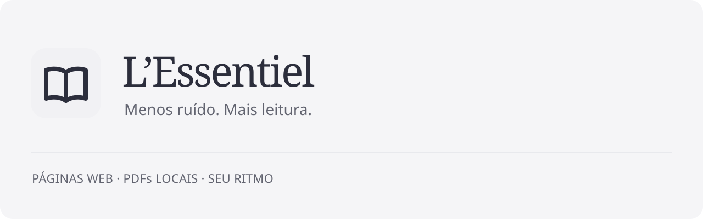

<picture>
  <source media="(prefers-color-scheme: dark)" srcset="assets/brand/banner-dark.svg">
  
</picture>

**Uma extensão para transformar páginas web e PDFs locais em uma leitura tranquila.**

[Baixar a prévia](https://github.com/BrunodosSantosVaz/lessentiel/releases/tag/v0.1.0-rc.2) · [Como instalar](https://github.com/BrunodosSantosVaz/lessentiel/wiki/Uso-e-instalacao) · [Documentação](https://github.com/BrunodosSantosVaz/lessentiel/wiki) · [Conversar sobre o projeto](https://github.com/BrunodosSantosVaz/lessentiel/discussions)

## O texto em primeiro lugar

- **Leia no seu ritmo.** Temas, fontes incluídas, tamanho, alinhamento, largura e rolagem automática.
- **Mantenha o contexto.** Índice hierárquico, citações, listas, tabelas, código e imagens editoriais opcionais.
- **Fique no seu dispositivo.** Processamento local de texto e preferências, sem conta ou sincronização.

## Experimente a nova prévia

A versão **0.1.0-rc.2** é uma candidata para homologação em navegadores Chromium, como Edge e Chrome. Instalação manual, acesso a arquivos, PDFs compatíveis e limitações estão no [guia de uso](https://github.com/BrunodosSantosVaz/lessentiel/wiki/Uso-e-instalacao). PDFs locais abrem primeiro no visualizador do navegador: ative e desative o leitor manualmente. O texto é recomposto em parágrafos e uma coluna. A homologação no navegador do dono continua pendente.

Encontrou um problema? [Abra uma issue](https://github.com/BrunodosSantosVaz/lessentiel/issues). Acompanhe o [quadro público](https://github.com/users/BrunodosSantosVaz/projects/33) e o [histórico de versões](https://github.com/BrunodosSantosVaz/lessentiel/releases).

---

[MIT](LICENSE) · [Segurança](SECURITY.md) · [Como contribuir](CONTRIBUTING.md) · Por [BrunodosSantosVaz](https://github.com/BrunodosSantosVaz).
O framework [Big Bang](https://github.com/BrunodosSantosVaz/big-bang) mantém sua [licença própria](.bigbang/LICENSE).
